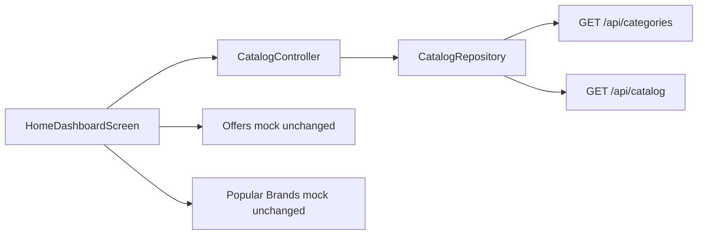

# Home Dashboard: Live Backend Data

## Scope (confirmed)

**Change to live API on Home only:**
- Shop by Category
- Featured Products
- Popular Products
- Product/category images from backend `imageUrl` only

**Leave as-is:**
- Auth (OTP / guest mock flow)
- Current Offers section
- Popular Brands section
- Location, search bar, app chrome

## Data flow

## Implementation

### 1. Expand API repository
In [`lib/features/catalog/data/repositories/catalog_repository.dart`](lib/features/catalog/data/repositories/catalog_repository.dart):
- Add `fetchCategories()` → `GET /api/categories`
- Keep/reuse `fetchPipeCatalog()` / full catalog fetch for products

Map API category JSON to domain `Category` (id, name, productCount, imageUrl).

### 2. Expand CatalogController for Home
In [`lib/core/state/catalog_controller.dart`](lib/core/state/catalog_controller.dart):
- Store `List<Category> categories` and full `List<ProductVariant> pipeVariants` (already present)
- Add `refreshHomeCatalog()` that loads categories + catalog (and can reuse existing poll via `startPipeCatalogSync`)
- Expose helpers for Home:
  - `homeCategories` (active categories from API)
  - `featuredVariants` / `popularVariants` derived from live catalog (e.g. top discounted / in-stock items)
  - `catalogProductsFromVariants` grouping for cards that expect `CatalogProduct`

Ensure product cards use `variant.imageUrl` from API (never local mock product assets).

### 3. Wire Home dashboard
In [`lib/features/home/presentation/screens/home_dashboard_screen.dart`](lib/features/home/presentation/screens/home_dashboard_screen.dart):
- `watch`/`read` `CatalogController` instead of `CatalogMockData` for categories, featured, popular
- On init: ensure catalog sync starts (`startPipeCatalogSync` + category fetch)
- Show loading / empty placeholders for those sections when API is empty or failing
- Keep offers + popular brands on `CatalogMockData` as today

### 4. UI model / image support
- Add optional `imageUrl` to [`HomeCategory`](lib/features/home/domain/models/home_models.dart)
- Pass `imageUrl` into [`CategoryImage`](lib/shared/widgets/category_image.dart) from [`HomeCategoryCard`](lib/features/home/presentation/widgets/home_category_card.dart)
- Update [`FeaturedProductsSection`](lib/features/home/presentation/widgets/featured_products_section.dart) / [`PopularProductsSection`](lib/features/home/presentation/widgets/popular_products_section.dart) to take live variants (or products built from API) and show `imageUrl`; remove `CatalogMockData.cheapestVariantFor` dependency for Home cards

### 5. Category navigation from Home
In [`lib/core/routes/app_router.dart`](lib/core/routes/app_router.dart):
- When Home taps a live category whose name matches pipes (`PIPES & FITTING` / contains "pipe"), open `PipesFittingCategoryScreen` (same as today for `pipes` / `cat-pipes-tubing`)
- Other API category ids fall through to browse screen

## Out of scope for this pass
- Auth rewrite
- Offers / Popular Brands mock removal
- Full app-wide purge of `CatalogMockData` from product detail, cart, category browse, etc.
- Deleting mock asset files (can stay unused by Home)

## Verification
- Home categories show server list (currently "PIPES & FITTING") with backend image
- Featured / Popular show live catalog rows with backend images (or icon fallback if URL invalid)
- Offers and Popular Brands still look the same
- Tapping pipes category still opens live Pipes and Fitting screen